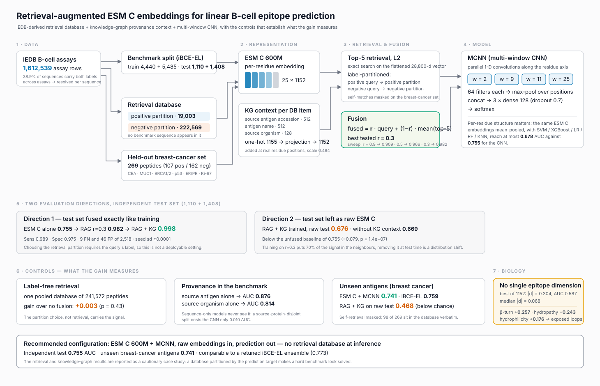

# Linear B-cell epitope prediction with ESM C embeddings, a multi-window CNN, and retrieval augmentation

Code for the manuscript in [`BCell_manuscript.docx`](BCell_manuscript.docx).



Two things this repository is for:

1. **A usable predictor.** ESM C 600M per-residue embeddings + a multi-window CNN (MCNN).
   Independent-test AUC **0.7552**, and **0.7411** on 269 held-out peptides from
   breast-cancer-associated antigens it never saw. It needs nothing at inference but the
   peptide sequence. **This is the configuration to use.**
2. **A reproducible cautionary case study.** Retrieval augmentation over an IEDB-derived
   database with knowledge-graph provenance context reaches AUC **0.9977** — and the
   controls here show that figure comes from partitioning the retrieval database by the
   prediction target, not from transferable epitope knowledge. Scripts for every control
   are included, because the result is only meaningful next to them.

| Configuration | Independent test | Breast-cancer set | Needs a label at test time? |
|---|---|---|---|
| **ESM C + MCNN** | **0.7552 ± 0.0012** | **0.7411 ± 0.0110** | no |
| iBCE-EL (our reproduction) | 0.7728 | 0.7586 ± 0.0049 | no |
| RAG r=0.3, test fused | 0.9819 ± 0.0035 | — | **yes** |
| RAG + KG r=0.3, test fused | 0.9977 ± 0.0001 | 0.9931 ± 0.0035 | **yes** |
| RAG + KG r=0.3, test raw | 0.6763 ± 0.0032 | 0.4681 ± 0.0162 | no |

Every number is the mean over 5 training seeds on held-out data.

---

## Install

Two environments, because the PLM stack and the training stack do not share a torch build.

```bash
conda create -n bcell-train python=3.9 tensorflow scikit-learn pandas openpyxl matplotlib scipy python-docx optuna
```

```bash
conda create -n bcell-esmc python=3.10 pytorch pytorch-cuda=12.1 -c pytorch -c nvidia && conda run -n bcell-esmc pip install esm==3.2.3
```

`bcell-esmc` is only needed to produce embeddings; everything else runs in `bcell-train`.

---

## Predict on your own peptides

### 1. Put your peptides in a FASTA

```bash
printf '>pep1\nSSKNPKKPKTVKPKK\n>pep2\nTLDVRMINIEASQLA\n' > dataset/MySet.fasta
```

Peptides are truncated to 25 residues in the embedding tensor. Scan a longer antigen with
overlapping windows rather than passing the whole protein.

### 2. Embed with ESM C

```bash
conda run -n bcell-esmc python code/get_ESMCEmbedding.py --sets MySet
```

This writes `dataset/ESMC/MySet.npy`, shape `(N, 1, 25, 1152)`, float16, plus
`MySet.order.txt` giving the FASTA id of every row.

### 3. Register it and run the model

Add an entry to `FEATURE_PATHS` in [`code/import_tests.py`](code/import_tests.py). The
`test` side is what gets scored; the `train` side stays the benchmark split:

```python
"MySet": {
    "neg": {"train": f"{DATASET_DIR}/ESMC/Train_neg.npy", "test": f"{DATASET_DIR}/ESMC/MySet_neg.npy"},
    "pos": {"train": f"{DATASET_DIR}/ESMC/Train_pos.npy", "test": f"{DATASET_DIR}/ESMC/MySet_pos.npy"},
},
```

The harness expects a positive and a negative file because it reports supervised metrics.
To score unlabelled peptides, split them arbitrarily into the two files and read the
predicted scores rather than the metrics.

```bash
conda run -n bcell-train python code/MCNN.py -df MySet -vm ind \
    -w 2 9 11 25 -f 64 -hi 128 -nh 3 -drop 0.7 -lr 0.002369195248294311 \
    -bs 128 -ep 20 -loss ce -seed 0 -save_model
```

Results append to `MCNN_ind_report.xlsx` (sheet `Independent`); ROC and PR curves go to
`PKL/`; `-save_model` writes weights and a JSON config to `saved_models/`.

**Interpreting the score.** Treat it as a ranking, not a probability. The intended use is
to take the top 20–30% of a peptide scan forward to synthesis and assay. Threshold-dependent
metrics in this repository use the max-G-mean-on-the-evaluated-set convention, which is
mildly optimistic; AUC and AP are not affected.

---

## Reproduce the paper

Run from the repository root with the benchmark data in `dataset/`.

```bash
conda run -n bcell-train python code/MCNN.py -df ESMC_RAW -vm ind -w 2 9 11 25 -f 64 -hi 128 -nh 3 -drop 0.7 -lr 0.002369195248294311 -bs 128 -ep 20 -loss ce -seed 0
```

```bash
conda run -n bcell-train python code/traditional_classifiers.py
```

```bash
conda run -n bcell-train python code/make_ragkg.py -ratio 0.3
```

```bash
conda run -n bcell-esmc python code/retrieve_bc.py -ratio 0.3
```

```bash
conda run -n bcell-train python code/make_breast_cancer_set.py
```

```bash
cd ibce_repro && conda run -n bcell-train python run_em1.py && conda run -n bcell-train python run_bc.py
```

Then the figures and the manuscript:

```bash
cd analysis && conda run -n bcell-train python figures.py && conda run -n bcell-train python tsne_importance.py && conda run -n bcell-train python feature_biology.py && conda run -n bcell-train python manuscript_figures.py && conda run -n bcell-train python manuscript_docx.py
```

### The controls

Run these before believing any retrieval result on this benchmark.

```bash
conda run -n bcell-train python code/provenance_leak_test.py
```

Source antigen alone predicts the label at **AUC 0.8763** on the independent test set;
source organism alone at **0.8142**. Both beat every sequence-only model here.

```bash
conda run -n bcell-train python code/make_protein_disjoint_split.py
```

Builds `ESMC_PDIS` (no source protein shared between train and test, provenance control
drops to 0.500) and `ESMC_RSPLIT` (matched random split, control stays at 0.876). The CNN
scores 0.7564 ± 0.0024 on the first against 0.7661 ± 0.0027 on the second — it loses only
0.0097, because it never sees provenance.

---

## Layout

| Path | What it is |
|---|---|
| `code/MCNN.py` | the model: training, cross-validation, independent test, Optuna search |
| `code/import_tests.py` | the dataset registry — every `-df` name resolves here |
| `code/get_ESMCEmbedding.py` | ESM C 600M per-residue extraction |
| `code/make_ragkg.py` | retrieval + knowledge-graph context fusion |
| `code/retrieve_bc.py` | retrieval for the breast-cancer set, with self-matches masked |
| `code/make_breast_cancer_set.py` | builds the held-out antigen validation set |
| `code/provenance_leak_test.py` | the provenance control |
| `code/make_protein_disjoint_split.py` | the source-protein-disjoint split |
| `code/traditional_classifiers.py` | SVM / RF / KNN / XGBoost / LR on mean-pooled embeddings |
| `analysis/` | every table and figure in the manuscript |
| `ibce_repro/` | reproduction of iBCE-EL (Front Immunol 2018;9:1695) |
| `figures/` | rendered figures, including the editable SVG overview |

## Data

All data derive from the public IEDB B-cell assay export. The benchmark split is the
published iBCE-EL split. The retrieval database (19,003 positive + 222,569 negative
peptides) is filtered so that no benchmark sequence appears in it. The breast-cancer set is
a **held-out IEDB antigen-family subset**, not an independent external cohort; 101 of 376
matching sequences were dropped for carrying both labels across assays and 6 more for
appearing in the benchmark.

Embedding tensors are not in this repository — regenerate them with
`code/get_ESMCEmbedding.py`.

## Known limitations

- Linear epitopes only; conformational epitopes are out of scope.
- 25-residue truncation affects long peptides, unevenly across classes in the
  breast-cancer subset (46.9% of negatives, 12.1% of positives).
- Peptide length differs between classes and is partly an artefact of dataset assembly; no
  length-matched control has been run.
- `code/MCNN_GKI.py` (a GOProteinGNN-style injection variant) is **not** in this release:
  it was a measured negative result (AUC 0.704 against 0.756 for the plain model) and the
  faithful version of that design, which injects only during pretraining and drops the
  graph at inference, was never tested.

## Citation

iBCE-EL, the baseline reproduced here: Manavalan B., Govindaraj R.G., Shin T.H.,
Kim M.O., Lee G. *iBCE-EL: A New Ensemble Learning Framework for Improved Linear B-Cell
Epitope Prediction.* Front Immunol 2018;9:1695.
