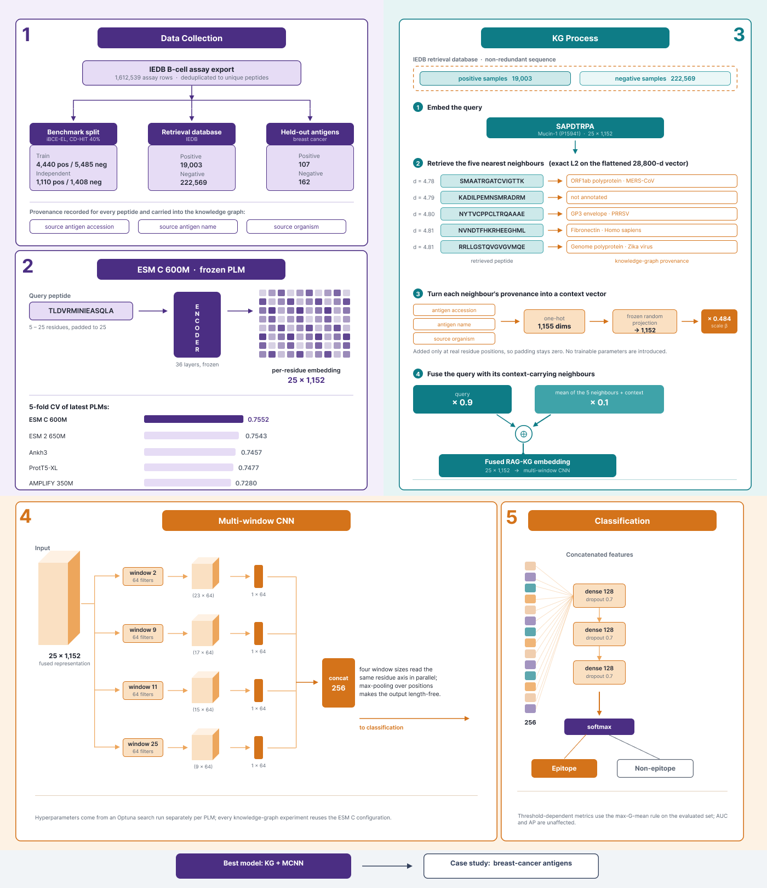

# bcell-epitope-rag

Linear B-cell epitope prediction from protein language model embeddings, with
retrieval augmentation and an immunological knowledge graph.

A linear B-cell epitope is a short contiguous stretch of an antigen that an
antibody recognises. Predicting one from sequence alone is hard, because a
peptide of 10–25 residues is presented without the structural context that
governs antibody accessibility, and published predictors have sat near AUC
0.75–0.80 for a decade.

This repository holds the code behind a study that asks what helps. It compares
five protein language models as frozen feature extractors, shows that a
multi-window CNN reading per-residue embeddings beats the same embeddings
mean-pooled into traditional classifiers, and then adds two things on top: a
retrieval database of 241,572 IEDB peptides filtered at 40% identity against the
benchmark with CD-HIT-2D, and a knowledge-graph context vector built from each
retrieved peptide's provenance — its source antigen accession, antigen name and
source organism. The context vector is a frozen random projection of a one-hot
indicator, so it adds no trainable parameters. On the iBCE-EL independent test
set the fused representation reaches AUC 0.9201 ± 0.0166 against 0.7552 ± 0.0012
for ESM C alone.



## Layout

```
code/              the pipeline, from IEDB download to training
examples/          an end-to-end walkthrough on a single peptide
saved_models/      MCNN checkpoints (weights + config + ROC/PR curves)
optuna_studies/    the Optuna databases of the hyperparameter searches
docs/              the study overview figure
```

## Install

```bash
conda create -n bcell python=3.10 && conda activate bcell && pip install -r requirements.txt
```

ESM C comes from the `esm` package (`esm==3.2.3`) and downloads its weights on
first use. TensorFlow 2.16 with a CUDA GPU is assumed for training; inference on
a handful of peptides runs on CPU.

## Two steps

### 1. Embed a sequence

ESM C 600M gives one 1,152-dimensional vector per residue, so a peptide becomes a
25 × 1,152 tensor, truncated or zero-padded to 25 positions.

```python
from esm.models.esmc import ESMC
from esm.sdk.api import ESMProtein, LogitsConfig

model = ESMC.from_pretrained("esmc_600m").to("cuda").eval()
tokens = model.encode(ESMProtein(sequence="SAPDTRPAPGSTAPPAHGVT"))
out = model.logits(tokens, LogitsConfig(sequence=True, return_embeddings=True))
emb = out.embeddings[0, 1:-1].float().cpu().numpy()      # (L, 1152), BOS/EOS removed
```

For a whole FASTA file use the batch script, which writes one text file per
peptide and one stacked array per set:

```bash
python code/get_ESMCEmbedding.py --dataset_dir ./dataset --out_dir ./dataset/ESMC
```

`code/get_T5Embedding.py` and `code/get_AMPLIFYEmbedding.py` do the same for
ProtT5-XL, Ankh3 and AMPLIFY.

### 2. Classify with the MCNN

The classifier applies parallel 2-D convolutions with window sizes 2, 9, 11 and
25 along the residue axis, 64 filters each, max-pools every branch over
positions, concatenates them and passes the result through three 128-unit dense
layers with dropout 0.7 to a two-way softmax. The window sizes and everything
else come from an Optuna search run separately per language model; the knowledge
graph experiments reuse the ESM C configuration unchanged.

Two checkpoints share this architecture and take a `(1, 1, 25, 1152)` input:

- `saved_models/MCNN_ESMC_RAGKG_r09` is the model trained with retrieval and
  knowledge-graph fusion at r = 0.9.
- `saved_models/MCNN_ESMC` is the sequence-only ESM C model.

Embed a peptide and score it with the r = 0.9 checkpoint:

```bash
python examples/predict_peptide.py --sequence SAPDTRPAPGSTAPPAHGVT --model saved_models/MCNN_ESMC_RAGKG_r09/best_MCNN_ESMC_RAGKG_r09.config.json
```

```
peptide            SAPDTRPAPGSTAPPAHGVT  (20 residues)
ESM C embedding    (1, 25, 1152)

P(epitope)         0.7787
prediction         epitope
```

The command passes the peptide's own ESM C embedding straight to the checkpoint.
That checkpoint was trained on embeddings fused with retrieved neighbours, so
this output shows how to call the model and what it returns; it is not a
calibrated prediction for the peptide.

To load the checkpoint in your own code:

```python
from MCNN import load_saved_model

model, saved = load_saved_model(
    "saved_models/MCNN_ESMC_RAGKG_r09/best_MCNN_ESMC_RAGKG_r09.config.json")
prob = model.predict(x)[:, 1]        # x: (n, 1, 25, 1152) float32
```

`saved` is the JSON stored beside the weights: the configuration and the
independent-test metrics the checkpoint was saved with.

To train on your own features:

```bash
python code/MCNN.py -maxseq 25 -df ESMC -w 2 9 11 25 -f 64 -hi 128 -nh 3 -drop 0.7 -lr 0.002369 -bs 128 -ep 20 -loss ce -vm ind -save_model
```

## Notes

- `iedb_bcell_raw.csv`, the 1.3 GB IEDB export, and the embedded retrieval store
  are not included. Both are regenerated by `code/iedb_bcell_download.py` and
  `code/get_ESMCEmbedding.py`.
